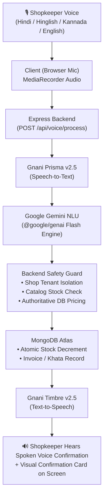

# 🎙️ DukaanVoice AI (दुकान आवाज)

> **Voice-First Kirana Store Management Platform for Bharat.**  
> A simple, multilingual web application that lets Indian neighborhood grocery shopkeepers manage inventory, sales billing, customer credit (Digital Khata), and business insights simply by speaking in everyday **Hindi**, **Hinglish**, **Kannada**, or **English**.

---

## Project Solution Pitch

Read the concise one-page solution pitch for **DukaanVoice AI**: [Solution Pitch](docs/SOLUTION_PITCH.md)

---

## 1. What is DukaanVoice AI?

**DukaanVoice AI** is a purpose-built store operating assistant for small retail and grocery (*kirana*) shopkeepers across India. Rather than requiring shop owners to navigate complex menus, type barcode numbers on keyboards, or maintain manual paper account registers, DukaanVoice AI allows store owners to control their entire business through natural voice conversations.

---

## 2. What Problem Does It Solve?

Neighborhood kirana stores operate in fast-paced, high-pressure environments:

* **Customer Queue Pressures**: During morning and evening rush hours, typing item names or searching through software slows down checkout, causing long queues.
* **Paper Khata Risk**: Many Indian store owners track customer credit (*udhaar*) in physical paper notebooks (*bahi-khata*). These books easily suffer physical damage, missing entries, arithmetic errors, and dispute-prone debt collections.
* **Complex Software Barriers**: Traditional enterprise ERP and billing software are built for corporate desktops with English-only interfaces, requiring extensive typing and computer training that non-technical shopkeepers find frustrating.
* **Stock Leakage & Blind Spots**: Store owners frequently run out of high-demand items (like cooking oil, milk, and lentils) without warning, or find that slow-moving stock ties up working capital.

**DukaanVoice AI** removes these barriers by letting the shopkeeper speak naturally at the counter. The system automatically reconciles inventory, generates bills, calculates customer dues, and speaks back clear confirmations in the shopkeeper's preferred regional language.

---

## 3. Main Features

### 📦 Voice-Based Inventory Management
* Add new products with buying and selling prices, units, and categories.
* Increase or decrease inventory stock by voice (*"Basmati chawal 10 kg badha do"*).
* Real-time stock status flags (In Stock, Low Stock alert, Out of Stock).
* Instantly check stock availability without leaving the counter (*"Parle-G kitna bacha hai?"*).

### 🧾 Voice Sales Recording & Sales History
* Record customer sales naturally through speech (*"I sold 3 packets of milk through UPI"*).
* Automatic total calculation using verified product prices stored in MongoDB.
* Support for **Cash**, **UPI**, and **Digital Khata** payment modes.
* Complete searchable Sales History with date filters, payment breakdowns, and printable receipts.
* Prevention of selling more stock than currently available on the shelf.
* Idempotency protection to prevent accidental duplicate sales from repeated voice commands.

### 📒 Digital Khata (Customer Credit & Payment Ledger)
* Create and manage individual customer credit profiles.
* Record customer debt (*udhaar*) instantly via voice (*"Rahul ke khate me 500 rupaye udhaar likh do"*).
* Record repayments (*jama*) when customers settle their balances via cash or UPI.
* Live balance calculation ensuring customers cannot be overcharged or under-recorded.
* Direct WhatsApp balance reminder button to share polite balance notices with customers.

### 📊 Business Dashboard & Insights
* Real-time KPIs: Today's revenue, transaction bill count, cash vs. UPI vs. Khata split.
* Low-stock warnings highlighting items that need immediate reordering.
* Overdue khata balance tracking showing total money owed to the store.
* Daily business summary briefing narrated in Hindi, Hinglish, or Kannada.
* Actionable recommendations covering restock priorities, credit recovery, and basket size improvements.

---

## 4. Technology Stack

* **Frontend**: React (Vite), Tailwind CSS, Lucide React Icons.
* **Backend**: Node.js, Express.js.
* **Database**: MongoDB with Mongoose ODM (strict shop-level tenant data isolation).
* **Authentication**: Password hashing with `bcryptjs` and signed JSON Web Tokens (JWT) stored in secure HTTP-only cookies (`dvai.token`) with 7-day expiry.
* **Speech AI**: **Gnani AI Indic Foundation Models**
  * **Prisma v2.5**: High-accuracy Indic Speech-to-Text (STT) for Hindi, Hinglish, and Kannada.
  * **Timbre v2.5**: Natural Indic Text-to-Speech (TTS) voice synthesis.
* **Natural Language Understanding (NLU)**: **Google Gemini** (`@google/genai` SDK) for dynamic intent extraction and multi-turn conversational follow-up memory.

---

## 5. How the Complete Project Works

The application architecture links a responsive single-page web interface with a secure Express backend and cloud AI services:

1. **Client Interface**: The shopkeeper accesses the dashboard from any smartphone, tablet, or laptop browser.
2. **Shop Isolation**: All database records (products, sales, customers, transactions) are strictly isolated by `shopId`. A user from Shop A can never see or modify data belonging to Shop B.
3. **Safety & Pricing Integrity**: Google Gemini identifies what the user said, but **never** invents prices or writes directly to the database. Product prices are looked up directly from MongoDB, available stock is verified, and financial transactions require explicit user confirmation on screen.

---

## 6. How Gnani AI is Integrated into the Application

DukaanVoice AI integrates official **Gnani AI Indic Foundation Models** via unified API authentication:

### 1. Gnani Prisma v2.5 (Speech-to-Text)
* **Endpoint**: `https://api.vachana.ai/stt/v3`
* **Purpose**: Captures audio buffers streamed from the shopkeeper's browser microphone and transcribes them into text.
* **Language Support**: Automatically maps user selections to official Prisma language codes (`hi-IN` for Hindi, `indic-auto` for Hinglish, `kn-IN` for Kannada, `en-IN` for English).

### 2. Gnani Timbre v2.5 (Text-to-Speech)
* **Endpoint**: `https://api.vachana.ai/api/v1/tts/inference`
* **Purpose**: Converts the assistant's written confirmations and daily business summaries into natural, expressive spoken audio.
* **Output**: Delivers 24kHz linear PCM WAV audio played directly through the browser speaker.

### 3. Google Gemini (Natural Language Understanding)
* **Purpose**: Parses transcribed voice commands in Hindi, Hinglish, Kannada, and English into structured intents and parameters.

---

## 7. The 7-Step Voice Workflow

Whenever a shopkeeper speaks a command, the system executes this end-to-end pipeline:

* **Step 1**: The shopkeeper taps the microphone icon and speaks naturally in Hindi, Hinglish, Kannada, or English (e.g., *"Maggi ke 10 packet bech diye"* or *"Rahul ko 500 rupaye udhaar likh do"*).
* **Step 2**: **Gnani Prisma v2.5** converts the audio stream into text (*"मैगी के 10 पैकेट बेच दिए"*).
* **Step 3**: **Google Gemini** analyzes the transcript, extracts the structured intent (`RECORD_SALE`), identifies target entities (`productName: "Maggi"`, `quantity: 10`), and detects if clarification is required.
* **Step 4**: The **Express backend** validates the request against the authenticated shop's catalog, checks available stock (`stock >= 10`), computes the total at authoritative database prices (10 x ₹14 = ₹140), and displays a confirmation card on screen.
* **Step 5**: The backend performs the operation inside an atomic **MongoDB** transaction, decrementing product stock, generating an invoice number, and recording an audit log entry.
* **Step 6**: **Gnani Timbre v2.5** converts the assistant's response (*"बिक्री पूरी हुई। Maggi के 10 पैकेट का बिल ₹140 दर्ज कर दिया गया है।"*) into natural speech.
* **Step 7**: The shopkeeper hears the confirmation through the speaker and sees the updated dashboard instantly.
